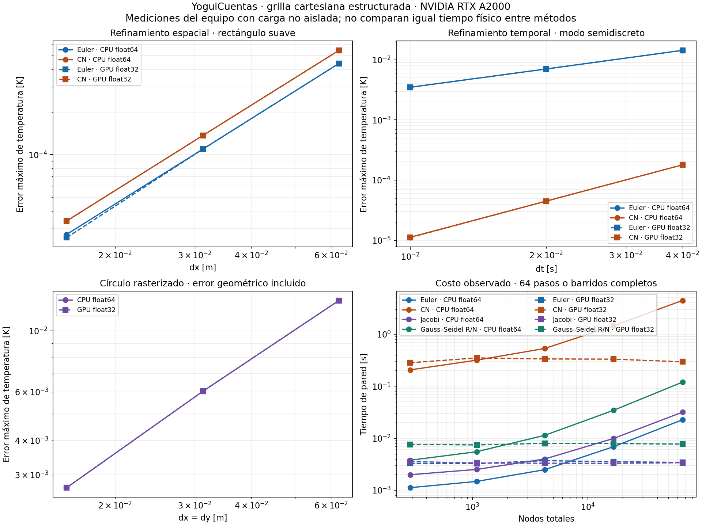

# Resultados numéricos del 28/10/2026

**217 comprobaciones cuantitativas aprobadas; 147 unittest aprobados, sin omisiones.**

Campaña sobre el desarrollo local posterior a 0.2.4. No verifica la instalación en otro equipo ni Metal.

CPU: AMD Ryzen 9 5900X 12-Core Processor. GPU: NVIDIA RTX A2000, índice 1, driver 570.86.10.
Python: 3.11.2; NumPy: 1.26.4. CPU float64 / OpenCL float32.

Los comandos se ejecutaron directamente en la workstation, quitando `CUDA_VISIBLE_DEVICES`, con `.venv/bin/python`. La A4000 no se utilizó en esta campaña final.

| Ensayo | CPU | GPU A2000 |
|---|---:|---:|
| Orden observado: temporal/explicit | 1.0275 / 1.0135 | 1.0275 / 1.0135 |
| Orden observado: temporal/crankNicolson | 2.0008 / 2.0002 | 2.0011 / 2.0159 |
| Orden observado: spatial/explicit | 2.0095 / 1.9996 | 2.0112 / 2.0730 |
| Orden observado: spatial/crankNicolson | 1.9966 / 2.0042 | 1.9970 / 2.0026 |
| Máximo error relativo de energía aislada | 3.6943e-13 | 1.9334e-07 |
| Máximo error del flujo de interfaz [W/m²] | 5.531e-10 | 0.00010934 |

La mayor diferencia CPU/GPU en los campos comparados fue **0.00014396 K**. Esta cifra incluye el efecto de detener los estacionarios con tolerancias distintas según precisión; no mide solo el redondeo de un mismo número de iteraciones.

## Geometría circular sobre la grilla cartesiana

| Grilla | Error máximo CPU [K] | Error máximo GPU [K] | Error relativo de área |
|---|---:|---:|---:|
| 17×17 | 0.0129054 | 0.0129054 | 10.724% |
| 33×33 | 0.0060335 | 0.0060335 | 1.343% |
| 65×65 | 0.0026942 | 0.0026942 | 0.615% |

El círculo usa R=0.31 m, k=1 W/(m K), Q=4 W/m³ y T=0 en el contorno continuo. El error disminuye con refinamiento, pero no se atribuye orden dos a la frontera escalonada.

## Iteraciones y costo

Una iteración de Gauss–Seidel contiene dos barridos, rojo y negro. Las tolerancias se guardan en `report.json`; los conteos entre CPU/GPU no comparan igual precisión de parada.

| Backend | Problema | Euler hasta estacionario | Jacobi | Gauss–Seidel R/N |
|---|---|---:|---:|---:|
| numpy | source | 2016 | 2432 | 864 |
| numpy | interface | 5376 | 2560 | 896 |
| numpy | mixed | 17824 | 19552 | 6752 |
| opencl | source | 928 | 1088 | 416 |
| opencl | interface | 2688 | 1280 | 480 |
| opencl | mixed | 7584 | 8256 | 2944 |

Los tiempos de 64 pasos/barridos y sus tamaños se conservan en `experiments.csv`. Incluyen la carga concurrente del sistema y el escritorio; no son tiempos exclusivos de una GPU. Menos iteraciones no implica necesariamente menos tiempo: Gauss–Seidel usa dos despachos por iteración y CN incluye sus iteraciones internas.

## Alcance y reproducción

- [Método, tolerancias y comandos](../../VERIFICACION_NUMERICA.md).
- [Informe completo JSON](report.json), [mediciones CSV](experiments.csv), [comprobaciones individuales](README.md).
- [Registro de la campaña](campaign.log) y [suite completa](unittest.log).
- La prueba de precisión finita exige que un caso float32 con residuo objetivo 1e−10 K/s termine **sin declarar convergencia**.
- La campaña M1 sigue pendiente. Su script y XCTest están preparados; no se compiló Swift/Metal en esta workstation Linux.
- La instalación del paquete en Debian/Devuan y la app en macOS requiere pruebas de destino independientes.

Hash SHA-256 de las fuentes Python/OpenCL examinadas: `5c964fca26615a3c11d14f537847b82b4342a2549ff65769e9859238cef51474`.
El JSON identifica el commit base y `dirty=true`, porque la campaña incorpora cambios locales aún no publicados. No se presenta como evidencia del binario original de la etiqueta 0.2.4.
